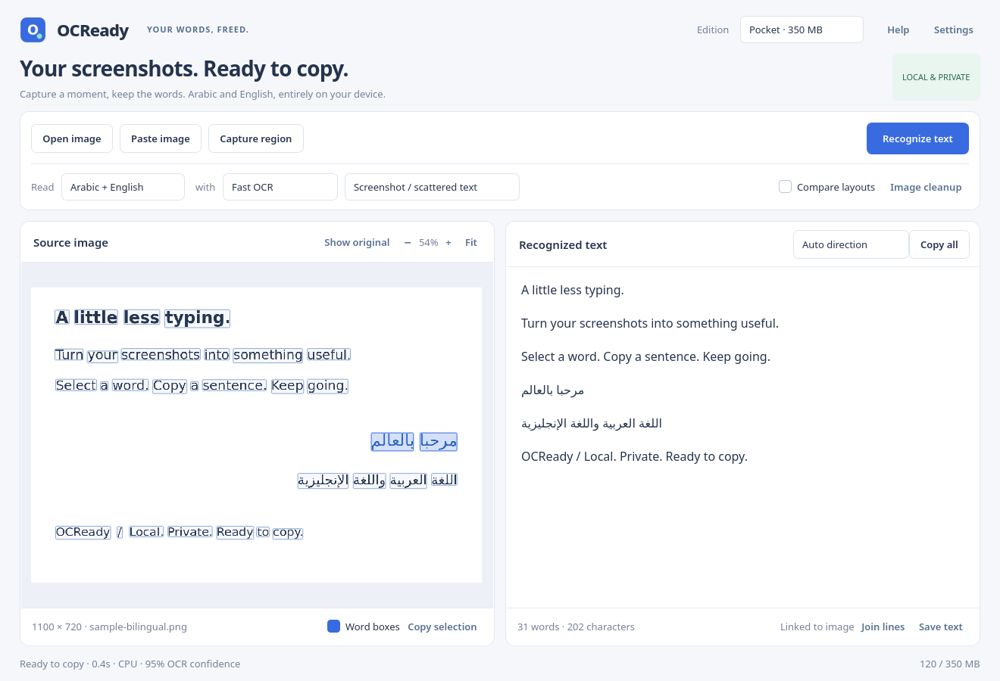

# OCReady

A local-first desktop workspace for turning Arabic and English screenshots into text you can select, edit, and copy.

**Under construction.** See [the modular implementation plan](docs/PLAN.md) and [iteration log](docs/PROGRESS.md). Memory tiers are engineering budgets until benchmarked; no vision model is claimed to fit a tier based on parameter count alone.

[Download the experimental Linux and Windows prerelease](https://github.com/DodoBird-debian/OCReady/releases/tag/v0.1.0-preview.1). It includes all three editions, checksums, build manifests, and measured resource reports. Development continues beyond that tagged snapshot.

The application uses a native Qt split view, offline Tesseract OCR, optional local vision-language models, reversible image cleanup, source-word highlighting, and KDE / Windows screenshot integration. Linux and Windows builds target one-file executables using Nuitka (compiled application and embedded runtime, extracted on launch).



## Development

```sh
uv sync --extra dev
uv run python scripts/prepare_runtime.py
uv run python -m ocready
uv run pytest
```

The same commands work with a normal virtual environment: install `.[dev]`, then use `python` directly. Debian runtime preparation extracts packages without requiring root. Windows preparation uses an existing Tesseract installation.

```sh
python -m ocready assets/sample-bilingual.png --json --layout sparse
python -m ocready --diagnostics
```

Open/paste/capture an image, choose **Recognize text**, and copy. Click or drag over the picture to select located words. Selecting editor text highlights its source; manual edits invalidate source linking until the next recognition. Image cleanup is reversible. Use F1 for shortcuts.

Enable **Compare layouts** to retain two OCR reads. The **Compare reads** selector lets you inspect and choose either result, including its own source boxes, without repeating inference. A higher OCR confidence can still omit text; verify the reading against the picture.

Use **Ctrl+C** with the picture focused to copy its selected words. The text pane keeps native selection copying. Automatic paragraph direction also follows Arabic and English as you edit or paste; Undo restores the text in one step.

Everyday admits smaller local vision-language packs; Studio admits larger ones. Configure one or more packs under **Settings → Vision models**; see [setup and measured results](docs/VISION.md). Real CPU inference, CUDA inference, and a GPU-failure-to-CPU fallback have been exercised on Linux. Vision output has no invented source boxes or confidence. Arabic uses classical OCR by default; the tested tiny vision alternative is English-only.

Fresh Everyday/Studio GUI sessions prefer Precision for bilingual text. Your method choice is remembered separately for each edition, along with the last available edition, layout, language, and compute backend. An explicit `--edition` overrides the saved GUI edition; headless defaults remain the build's default.

## Compiling a single executable

```sh
uv run python scripts/prepare_runtime.py --best
uv run python scripts/build.py --edition pocket
uv run python scripts/smoke_binary.py dist/pocket
```

Use `everyday` or `studio` for the other editions. A onefile build embeds Qt, the selected OCR runtimes and model data, then extracts a private payload at startup. Vision packs can be external or embedded. For a single-method build with all vision assets inside the executable:

```sh
uv run python scripts/build.py --edition everyday --methods vision \
  --model-pack /absolute/path/to/pack.json
```

Repeat `--model-pack` to embed multiple compatible models, or use `--methods fast,best,vision` for a combined build. Installed models run sequentially. A 269.7 MB Linux vision-only executable with an English-only small model passed real CLI/GUI inference and its full 8 MP GUI memory workload at 921 MB. GitHub Actions builds the default Linux and Windows editions separately; artifacts remain prereleases until their platform and resource gates pass.

Build manifests record the source revision, source-content digest, dirty state, dependency versions, and included asset hashes. Keep sources unchanged during compilation; the build rejects a changed source tree before producing distribution metadata. Benchmark reports identify the measured executable by SHA256.

Tag builds can publish verified experimental prereleases after all six packaged checks pass. See [release evidence and preparation](docs/RELEASING.md).

No document content is uploaded. Vision inference is a local subprocess. Model installation is explicit.

## Editions

| Edition | Whole application + child-process RAM budget | Default methods |
| --- | --- | --- |
| Pocket | below 350,000,000 bytes | Tesseract fast, sparse text, reversible image cleanup |
| Everyday | below 1,000,000,000 bytes | Pocket methods, best language data, comparison, admissible small vision packs |
| Studio | below 4,000,000,000 bytes | Everyday methods, optional local GGUF vision inference |

Budgets use decimal MB/GB. GPU VRAM is separate and must also be reported. Small-tier vision models require a measured complete inference footprint before admission. Arabic accuracy and Windows behavior are separate validation gates.

See [measured memory workloads and limitations](docs/MEMORY.md). The Linux Pocket executable at `65bd416` peaked at 314 MB in the cap-sized GUI benchmark, including its launcher. All three Linux source editions passed their documented workloads. These measurements are not universal hard-memory certifications.

The [accuracy corpus and evaluator](docs/ACCURACY.md) track character/word errors across Arabic and English styles, including difficult cases. Passing resource tests is separate from transcription accuracy.

## License

GPL-3.0-or-later. Qt/PySide and bundled OCR components retain their own notices. See [third-party notices](docs/THIRD_PARTY.md).
