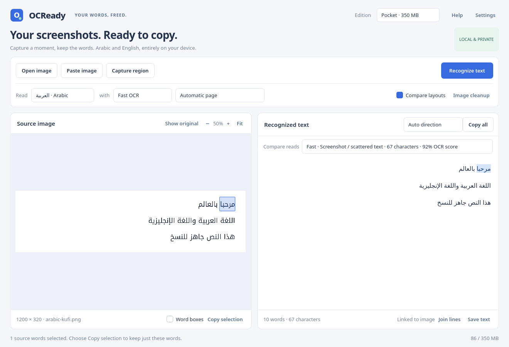

# Arabic and English accuracy evaluation

The committed corpus contains eleven original synthetic screenshots with ground-truth Unicode text and image SHA256 values. It includes English, Arabic, mixed scripts/digits, Naskh/Kufi/UI fonts, diacritics, small Arabic, dark/low-contrast backgrounds, and a corrected quarter-turn rotation. The raster files are committed so Linux and Windows evaluate identical pixels without requiring the rendering fonts at runtime.

Evaluate Fast and Precision sequentially:

```sh
uv run python -m scripts.accuracy evaluate
uv run python -m scripts.accuracy evaluate --layout auto --compare \
  --output test-output/accuracy-layouts.json
```

Character error rate (CER) is character edit distance divided by reference character count. Word error rate (WER) uses whitespace-separated words. Normalization performs Unicode NFC and collapses whitespace; it retains diacritics, Arabic/Western digit differences, punctuation, and directional controls. Rates can exceed 100% when output contains many extra characters. Weighted summaries use reference counts and show completed/skipped/error counts. Unsupported vision-pack languages are skipped explicitly and are not scored as correct output.

Reports include expected/actual text because every fixture is original public test material. They include source state and the corpus digest. This differs from resource benchmarks, which remove recognized document contents. Custom corpora should contain material suitable for the chosen report location.

The first exploratory runs found exact recognition for several clean English/Arabic font cases, but substantial errors on diacritics, small Arabic, and mixed digits. Precision recovered bilingual lines that Fast omitted. Layout comparison improved the small-text case but could also choose an incomplete result with higher OCR confidence. Confidence is therefore a diagnostic, not measured transcription accuracy. These findings motivate visible alternatives and further detection/layout work.

## First clean-source baseline

Linux, prepared Tesseract 5.5.0, clean source `1595c32`, the committed eleven fixtures. The reports identify source and corpus digests and confirm that sources remained unchanged during evaluation.

| Method | Screenshot layout CER / WER | Automatic + comparison CER / WER |
| --- | ---: | ---: |
| Fast | 29.2% / 26.7% | 28.4% / 28.3% |
| Precision | 9.9% / 11.7% | 7.5% / 8.3% |

These are weighted error rates on this synthetic corpus, not overall product accuracy. Arabic diacritics remain particularly poor (68.1% CER even with Precision in these runs). Screenshot layout read the Kufi case exactly with Fast, while confidence-based comparison selected a worse 49.2% CER result. Comparison did improve small Arabic from 30.8% CER to zero. A user must be able to inspect alternatives rather than assume higher confidence guarantees complete transcription.

Later clean-source runs completed all eleven fixtures with neural OCR at 3.9% CER / 7.5% WER ([report](accuracy/linux-neural-v5.json)) and quantized Qwen3-VL on CUDA at 7.0% / 13.3% ([report](accuracy/linux-qwen3-cuda.json)). Qwen read the clean bilingual example exactly but changed `٢٥٠٠` to `٢٠٠٠` in the mixed-digit fixture and had 41.7% diacritic-case CER. These different engine configurations are separate measured baselines. Generative fluency does not establish exact transcription, and none of these small synthetic runs certifies real-world accuracy.

Raw case-by-case references, output and scoring: [Screenshot layout](accuracy/linux-sparse.json), [Automatic plus comparison](accuracy/linux-compare.json).

The desktop now exposes both comparison reads, rather than discarding the alternative selected against by the confidence heuristic. This real Kufi example shows the complete Screenshot reading chosen manually and an Arabic word linked to its source:



This small synthetic corpus does not establish real-world accuracy. It lacks camera perspective, handwriting, complex tables and many font/print conditions. Adding representative, redistribution-safe examples and auditing reading order remain ongoing work. Do not describe `1 - CER` as a universal product accuracy percentage.

Regeneration requires Qt and the named DejaVu/Noto Arabic font families:

```sh
uv run python -m scripts.accuracy generate
```

Inspect the rendered images after regeneration and review ground truth/image digests together. Never change expected text to match a wrong recognition result.

Reports retain `corpus_sha256` for the exact manifest bytes and `corpus_content_sha256` for canonical JSON content. The latter is stable across Git's LF/CRLF checkout formatting and JSON key/whitespace formatting; it still includes exact expected Unicode, image hashes and preprocessing recipes. No OCR-text normalization is applied to this identity. Release verification also checks every case's ID, language, expected text and actual model identity against the committed corpus and embedded choices.
