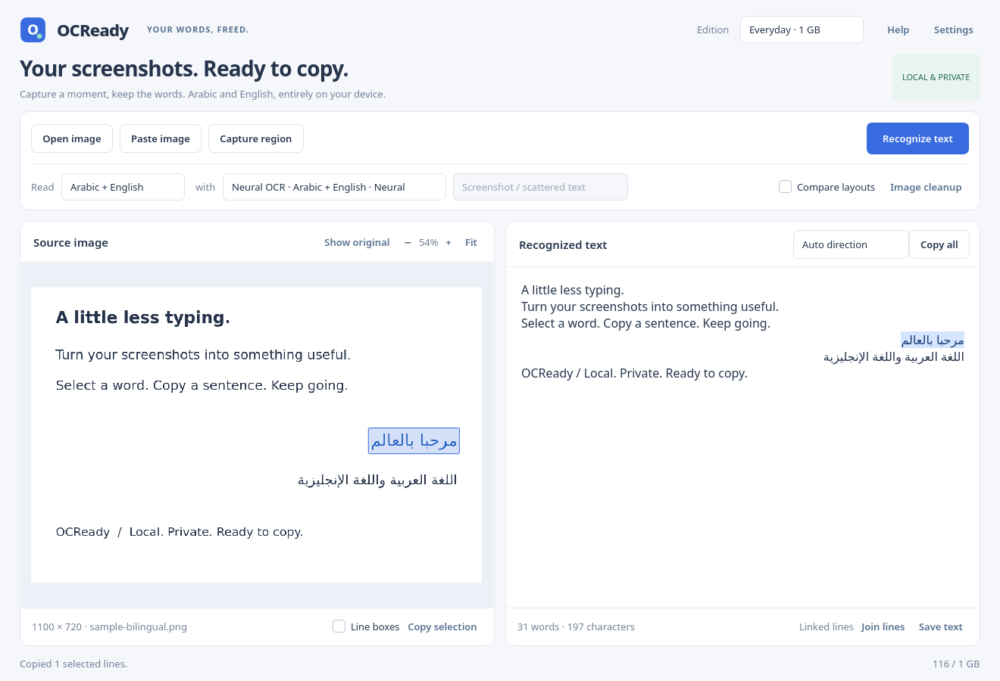

# Local neural OCR

OCReady supports an additional non-generative OCR family alongside Tesseract and local vision-language models. The first pack uses official PP-OCRv5 mobile detection and Arabic recognition ONNX models. It runs in a separate compiled worker, so numerical libraries and model sessions unload after each job.

Everyday and Studio admit this runner subject to their image/memory checks. Pocket continues to use its compact classical engine. The approximately 13 MB of model files are not an inference-memory claim: a real compiled-worker run on the bilingual example observed about 313 MB including its small parent harness; a native source GUI run observed about 398 MB including the worker. Larger images and complete onefile variants need their own benchmarks.

The detector provides real text-line polygons. The application highlights enclosing line regions and labels its controls **Line boxes**. Clicking a line copies the whole detected line. Individual word positions are not fabricated. Tesseract remains the method for word-level selection.



## Building a worker and pack

```sh
uv sync --extra dev --extra neural
uv run python -m scripts.build_neural_runner
uv run python -m scripts.prepare_neural
uv run python -m ocready assets/sample-bilingual.png --edition everyday \
  --method neural --neural-pack models/ppocr-v5/pack.json --json
```

The standalone worker includes its Python/numerical runtime; users do not need Python installed to run it. The outer application can embed the entire worker, model files, dictionary and notices in one executable:

```sh
uv run python -m scripts.build --edition everyday --methods neural \
  --neural-pack models/ppocr-v5/pack.json --variant neural
uv run python -m scripts.smoke_binary dist/everyday-neural --benchmark
```

For a combined build use `--methods fast,best,vision,neural`, with `--model-pack` and `--neural-pack` as needed. Repeat pack arguments to include multiple compatible choices. Separate variants keep custom outputs from replacing the default-edition artifacts. Each complete combination must pass its own packaged memory checks.

Import an external pack using **Settings → Neural OCR → Import local pack**. Built-in packs appear automatically. The settings retain options without moving or deleting model files. The shared Compute selector applies to neural and vision methods. The tested worker is CPU-based; it reports CPU when CUDA is not usable. A CUDA-capable compatible worker may be supplied separately, and backend initialization failures can fall back to CPU. Actual neural CUDA inference remains a separate validation task.

## Copy order and model provenance

The tested Arabic CTC recognizer emits visual scan order. The worker converts it into logical Unicode for copying. Automatic conversion uses an Arabic paragraph base when Arabic is present; English-only runs keep their normal order, digits, punctuation and email addresses. For English-led paragraphs containing inline Arabic, choose **English paragraph base** in pack options. Bidi inversion is ambiguous for some mixed layouts; this option is explicit rather than silently reversing all text. Models that already emit logical text can disable the conversion.

The locked sources are [the official mobile detector](https://huggingface.co/PaddlePaddle/PP-OCRv5_mobile_det_onnx) at `e6f4fa85f00e168c862bc462aebca69eef9b3d3d` and [the official Arabic recognizer](https://huggingface.co/PaddlePaddle/arabic_PP-OCRv5_mobile_rec_onnx) at `14aaedcd75825982689ecf5cd64ab33ee083215a`. Model/config SHA256 values and the derived character dictionary digest are stored in `assets/neural-lock.json`. Preparation verifies every download and derives the dictionary from the locked official configuration.

The worker refuses automatic model/font downloads and disables ONNX Runtime telemetry. Embedding copies only declared, hash-verified files from the standalone worker manifest, rather than unrelated files beside an arbitrary executable. Model, runtime and Python notices travel with the pack.

## Accuracy and memory checks

```sh
uv run python -m scripts.accuracy evaluate --methods neural \
  --neural-pack models/ppocr-v5/pack.json
uv run python -m scripts.benchmark --edition everyday \
  --neural-pack models/ppocr-v5/pack.json
```

The clean `b2576b9` Linux neural-only executable is 194.2 MB on disk. Its four packaged workloads passed; the complete 8 MP GUI process tree peaked at 531.1 MB, including cold startup and descendants. The separate repeated source-GUI workload peaked at 591.5 MB. These measured configurations fit Everyday's 1 GB budget; they do not certify every model, image or machine. Raw reports: [packaged](benchmarks/linux-neural-v5-onefile.json), [source](benchmarks/linux-neural-v5-source.json).

The same clean revision completed all eleven synthetic fixtures with 3.9% weighted character error and 7.5% word error ([raw accuracy report](accuracy/linux-neural-v5.json)). Diacritic-heavy text still had 38.9% character error. The small synthetic corpus is an engineering regression tool, not a real-world accuracy certification. Diacritics and mixed reading order still require inspection. Neural line recognition scores are not comparable to Tesseract confidence or VLM output.
